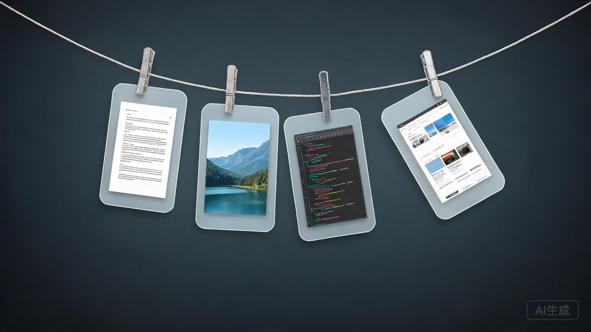
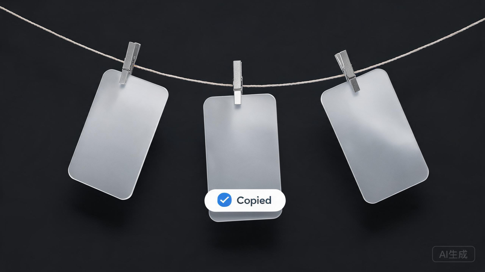
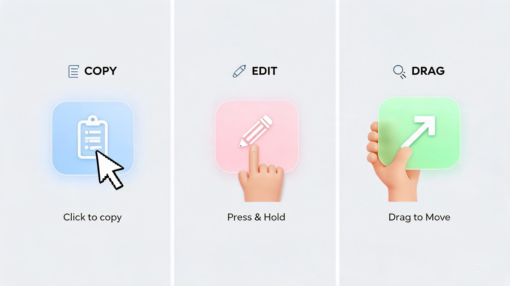

# Clothesline

<p align="center">
  
</p>

<p align="center">
  <em>Screenshots, hung out to dry.</em>
  <br/>
  <sub>A Windows clothesline for your screenshots. Rest the pointer at the top of the screen and the line glides down.</sub>
</p>

<p align="center">
  Free and open source. For Windows 10 1809 or later.

  <a href="#download">Download&nbsp;&rsaquo;</a>
  &nbsp;&nbsp;
  <a href="#build-from-source">Build from source&nbsp;&rsaquo;</a>
</p>

***

## Out of sight. Within reach.

Every screenshot you take hangs on a line just above your screen.
Rest the pointer at the top edge and it glides down. Move away and it's gone.

<p align="center">
  
</p>

## A gesture for everything.

<p align="center">
  
</p>

| | |
|:--|:--|
| **Click** | Copy the image. |
| **Press and hold** | Open it in your image editor. |
| **Double click** | Open it at full size. |
| **Drag into an app** | Send a copy. It stays on the line. |
| **Drag into a folder** | Keep it there. It leaves the line. |
| **Drag to the Recycle Bin, or click the ✕** | Let it go. |
| **Rest the pointer at the top edge** | Bring the line down. |
| **Move the pointer away** | Tuck it back up. |
| <kbd>Ctrl</kbd> + <kbd>Alt</kbd> + <kbd>T</kbd> | Show or hide the line. |

## Your desktop. Finally clear.

Hand Clothesline your screenshots and they skip the Desktop entirely.
No clutter. No five-second wait. Each capture hangs the instant you take it,
and only what you drag out is kept. Same shortcuts. Same muscle memory. Just
less mess.

## Private by design.

No account. No network. No analytics.
Clothesline runs entirely on your PC, and your screenshots never leave it.

## Tech Specs

| | |
|:--|:--|
| **Compatibility** | Windows 10 1809 or later, x64 |
| **Size** | ~160 MB (self-contained) |
| **Languages** | English, Español, 中文, 日本語, Français |
| **Built with** | C# 13, WPF, .NET 9 |
| **Network access** | None |
| **Price** | Free |
| **License** | MIT |

## Download

Grab the latest `Clothesline-win-x64.exe` from the
[Releases](../../releases/latest) page. It's a self-contained single-file
executable — no .NET runtime install required. Just double-click and go.

Or install it with **winget**:

```powershell
winget install Clothesline
```

## Build from source

The easiest way is the bundled build script:

```powershell
git clone https://github.com/Zhao-allen/Clothesline.git
cd Clothesline
.\build.ps1 -Clean -Zip
```

Or manually:

```powershell
dotnet build -c Release
dotnet publish -c Release -r win-x64 `
  --self-contained true `
  -p:PublishSingleFile=true `
  -p:IncludeNativeLibrariesForSelfExtract=true `
  -o publish
```

The EXE appears in `publish/Clothesline.exe`. Requires the **.NET 9 SDK** with
the WPF workload.

<details>
<summary>Inside the app</summary>

| File | Role |
|:--|:--|
| `App.xaml.cs` | Startup, services wiring, tray, hotkey, watchers |
| `UI/LineWindow.xaml.cs` | Transparent topmost strip, slide in/out, mouse tracking |
| `UI/PeggedCard.cs` | One photo: glass frame, clip, swing and breeze |
| `UI/TrayIcon.cs` | System tray menu (WinForms `NotifyIcon`) |
| `UI/Layout.cs` | Math: parabolic rope, card spacing, sizes |
| `Services/ScreenshotWatcher.cs` | Notices new screenshots |
| `Services/ClipboardWatcher.cs` | Hangs copied images from the clipboard |
| `Services/HotKey.cs` | Global `Ctrl+Alt+T` |
| `Services/FullScreen.cs` | Knows when to stay hidden |
| `Services/Inbox.cs` | Where captured screenshots are kept |
| `Services/Settings.cs` | JSON-backed persisted settings |
| `Services/I18n.cs` | Culture selection, resource lookup |
| `Resources/Strings.*.resx` | Localized UI strings |

</details>

## Languages

Clothesline ships with **five languages** and follows the system UI language
automatically. Pick one from the tray menu → **Language**.

| Code | Language | Native name |
|:--:|:--|:--|
| `en` | English | English |
| `es` | Español | Español |
| `zh` | 中文 | 中文 |
| `ja` | 日本語 | 日本語 |
| `fr` | Français | Français |

To add a translation, drop a `Strings.<culture>.resx` file in `Resources/`
and add the culture code to `SatelliteResourceLanguages` in `Clothesline.csproj`.
The tray menu picks it up automatically.

***

<p align="center">
  <sub>The code is MIT licensed. The Clothesline name and icon are not, so forks need their own. See <a href="LICENSE">LICENSE</a>.</sub>
  <br/>
  <sub>Inspired by <a href="https://github.com/alejandrobujan/tendedero">Tendedero</a> by <a href="https://alejandrobujan.com">Alejandro Buján</a>. Clothesline is an independent Windows port and is not affiliated with the original project.</sub>
</p>
